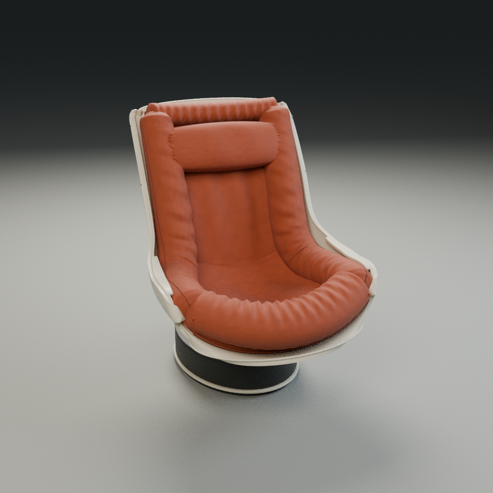

# Fotel — model 3D 1:1 dla Blendera

Model na podstawie zdjęcia, o przyjętych wymiarach **900 × 1100 × 1150 mm**
(szerokość × głębokość × wysokość). Skala: 1 jednostka Blendera = 1 metr.



Wersja 2 ma osobną poduszkę zagłówka, pełniejszy wałek z przodu siedziska,
marszczone poduszki boczne i mniej wyeksponowaną podstawę. Zgodnie z ustaleniem
model obejmuje sam fotel, bez koca.

**[Porównanie wersji 1 i 2 z tej samej kamery](chair/review/README.md)**

**[Kontrola dopasowania do osoby 200 cm](chair/ergonomics/README.md)** — pomiary
przestrzeni między poduszkami i położenia zagłówka. Wymiary V2 były założeniem
wizualnym; model nie jest jeszcze dopasowany do konkretnego użytkownika.

## Pobieranie

- **[Pobierz całe repozytorium jako ZIP](https://github.com/fawq/test-codex/archive/refs/heads/main.zip)** — zawiera kod, gotowe modele i rendery.
- [Gotowy model Blender (.blend)](chair/output/chair.blend)
- [Model przenośny (.glb)](chair/output/chair.glb)
- [Generator w Pythonie](chair/build_chair.py)
- [Rzuty z wymiarami (.svg)](chair/output/dimensions.svg)
- [Pełna instrukcja i założenia modelu](chair/README.md)

Plik `.blend` można od razu otworzyć w Blenderze. Na stronie pliku na GitHubie
użyj przycisku **Download raw file**, aby pobrać pojedynczy model. Dla prywatnego
repozytorium zaloguj się na konto GitHub z dostępem do niego.

## Odtwarzanie modelu

W Blenderze 4.3.2 lub zgodnej nowszej wersji, z katalogu `chair`:

```sh
blender --background --threads 8 --python-exit-code 1 --python build_chair.py -- --output output
blender --background --python-exit-code 1 --python validate_model.py -- output
```

Generator korzysta wyłącznie z bibliotek dostarczanych z Blenderem. Gotowe
wyniki są zapisane w `chair/output/`, więc pobranie modelu nie wymaga renderowania.
Weryfikacja obejmuje jednostki, gabaryty, zamknięcie 31 siatek i eksport GLB.

Wymiary są założeniem zaakceptowanym dla modelu, a nie pomiarem oryginału.
Koc pominięto. Konstrukcja ze sklejki i wykroje CNC wymagają osobnego opracowania.
