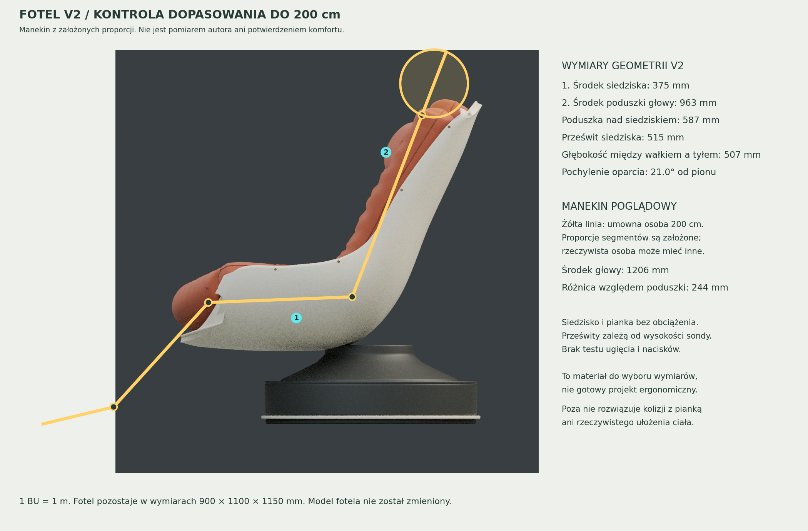

# Dopasowanie wersji 2 do osoby o wzroście około 200 cm

**Wersja 2 odtwarza wygląd fotela; jej wymiary nie były dobierane do konkretnej
osoby o wzroście 2 m.** Gabaryty 900 × 1100 × 1150 mm były założeniem wizualnym.
Poprawna skala pliku i zamknięte siatki nie potwierdzają dopasowania do człowieka.



## Wyniki pomiaru gotowej siatki

Pomiary dotyczą **nieobciążonej geometrii**, bez ugięcia pianki. Dokładne
współrzędne sond i definicje są w [current_fit.json](current_fit.json).

| Wielkość | Wynik dla V2 | Znaczenie |
| --- | ---: | --- |
| Wysokość środka siedziska | 375 mm | Nisko położony, zagłębiony środek; po obciążeniu może być jeszcze niżej |
| Szczyt przedniego wałka w osi fotela | 498 mm | Około 123 mm ponad środkiem siedziska; wymaga sprawdzenia podparcia ud i ugięcia |
| Najwyższy punkt przedniego wałka | 557 mm | Maksimum całego łuku, również przy bocznych końcach; nie jest wysokością całego przodu siedziska |
| Prześwit między bocznymi poduszkami przy siedzisku | 515 mm | Mierzony 65 mm ponad środkiem poduszki, na jej środkowej współrzędnej Y |
| Głębokość między wałkiem a oparciem | 507 mm | Poziomy odstęp na wysokości 50 mm ponad środkiem siedziska; nie długość po krzywiźnie |
| Środek poduszki zagłówka nad podłogą | 963 mm | Pozycja istniejącej poduszki, bez regulacji |
| Środek poduszki zagłówka nad środkiem siedziska | 587 mm | Sugeruje zbyt niskie podparcie głowy dla bardzo wysokiej osoby |
| Pochylenie środkowej powierzchni oparcia od pionu | około 21° | Oszacowane z przekroju oparcia na wysokości 650–850 mm |
| Prześwit w górnej części oparcia | około 370–391 mm | Sondy 25 mm przed środkowym panelem, na wysokości 750–950 mm; nie jest to całkowita szerokość skorupy |

Ostatni wymiar wymaga uwagi: grube poduszki boczne mocno ograniczają przestrzeń
przy oparciu. Sam wzrost nie określa szerokości barków i bioder; należy je zmierzyć
i sprawdzić przekrój poduszek na wysokości rzeczywistych barków użytkownika.

## Co pokazuje manekin

Żółty schemat ma umownie 2000 mm wzrostu. Jego segmenty to: stopa do kostki
60 mm, podudzie 500 mm, udo 510 mm, biodro–szyja 690 mm i szyja–czubek głowy
240 mm. **To założone proporcje, a nie pomiary autora ani dane percentylowe.**

Schemat ustawiono względem istniejącego siedziska i pochylenia oparcia. Środek
głowy wypada w nim około **244 mm wyżej** niż środek obecnej poduszki zagłówka.
Ta różnica pokazuje potrzebę kontroli podparcia głowy; nie jest zaleceniem, by
przesunąć zagłówek dokładnie o 244 mm u rzeczywistej osoby. Schemat nie rozwiązuje
kolizji ciała z poduszkami, ugięcia pianki, nacisków ani ustawienia miednicy.

## Kierunek dopasowania

Nie należy powiększać całego fotela proporcjonalnie do wzrostu. Wzrosłyby także
wysokość przedniego wałka, grubość poduszek, podłokietniki i podstawa, mimo że
każdy z tych elementów wymaga osobnego doboru.

1. Ustalić wysokość **obciążonego** siedziska na podstawie wysokości podkolanowej
   i docelowej pozycji nóg. Zmniejszyć różnicę wysokości między środkiem a wałkiem,
   jeśli próba z użytkownikiem wykaże ucisk pod udami.
2. Dopasować użyteczną głębokość do odległości pośladek–zgięcie kolana,
   pozostawiając miejsce za kolanem; nie przyjmować 1100 mm gabarytu za głębokość siedziska.
3. Wydłużyć górną część oparcia i dopasować pozycję osobnej poduszki do potylicy.
   Regulacja położenia zagłówka pozwoli skorygować różnice w proporcjach ciała i ugięciu.
4. Poszerzyć przestrzeń na barki przez zmianę poduszek bocznych lub skorupy,
   jeżeli pomiar użytkownika wykaże taką potrzebę.
5. Sprawdzić ustawienie podłokietników i stabilność podstawy po zmianie bryły.

Do kolejnego modelu potrzebne są przede wszystkim: dokładny wzrost, wysokość
podkolanowa, długość pośladek–zgięcie kolana oraz odległości od siedziska do barków
i potylicy w docelowej pozycji. Warto dodać szerokość bioder i barków oraz informacje
o piance. Przed CNC przydatna będzie przymiarka w skali 1:1 z regulowanym siedziskiem
i oparciem; siatka wizualna nie zastępuje tego sprawdzenia.

## Repozytorium autora

Adres: [zurekpiotr/Fotel](https://github.com/zurekpiotr/Fotel).
Użytkownik potwierdził, że jest prywatne. Odczyt z tego środowiska zakończył się
403 przez Git, strona publiczna zwróciła 404, a istniejące uwierzytelnienie CLI
nie umożliwiło zapytania API. **Nie odczytano zawartości repozytorium i nie wiadomo,
czy autor uwzględnił w nim swój wzrost.** Do tej oceny potrzebny jest ZIP projektu
lub udostępnienie repozytorium integracji GitHub używanej przez środowisko.

## Odtworzenie pomiaru

Z katalogu `chair`, bez zmieniania pliku modelu:

```sh
blender --background --python-exit-code 1 --python ergonomics/audit_fit.py
python ergonomics/render_fit_sheet.py
```

Pierwszy krok używa wyłącznie Blendera i zapisuje JSON oraz samodzielny SVG.
Drugi wymaga Matplotlib i Pillow oraz tworzy podgląd PNG. Raport przechowuje SHA-256
mierzonego pliku `.blend` i rzutu bocznego. Nakładka korzysta z istniejącego
`output/side.png`; przy zmianie modelu należy najpierw odtworzyć rzut z tej samej wersji.
