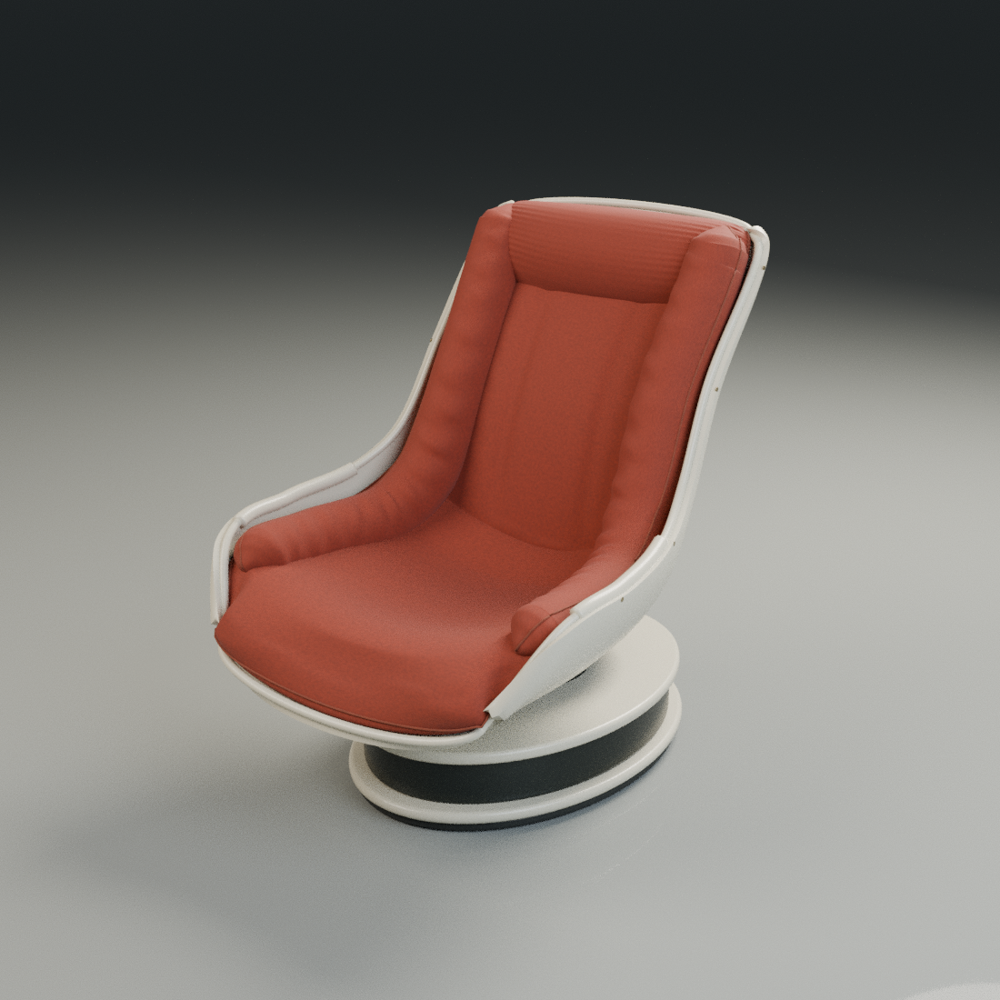
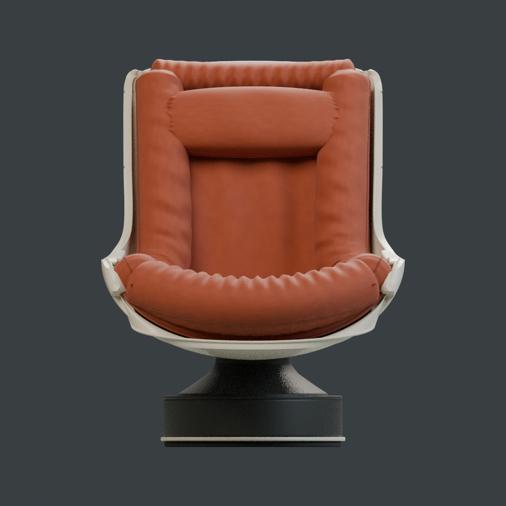
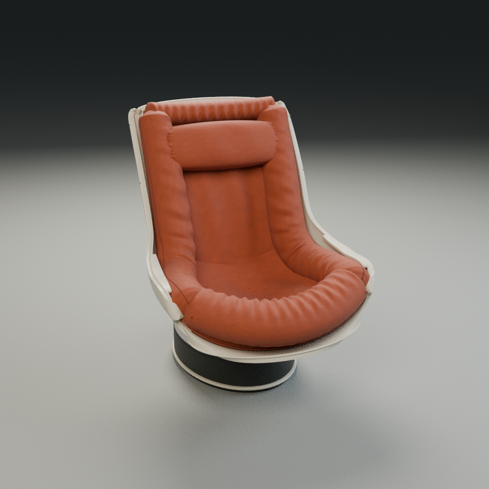

# Porównanie wersji 1 i 2

Kierunek poprawki: większe podobieństwo do fotela na zdjęciu, przede wszystkim
w bryle tapicerki i relacji skorupy do podstawy. Bez koca, zgodnie z ustaleniem.
Nie znamy dokładnego powodu niezadowolenia autora; poniższe priorytety wynikają
z widocznych różnic między fotografią a pierwszym modelem.

| Element | Różnica w wersji 1 | Zmiana w wersji 2 |
| --- | --- | --- |
| Zagłówek | Wtopiony w oparcie, przypominał zintegrowany panel | Osobna, pełna poduszka prostokątna z miękkimi narożnikami i marszczeniami przy bokach |
| Siedzisko | Gładki, stosunkowo płaski przód | Wyraźny, napompowany wałek po łuku z przodu; środek pozostaje zagłębiony |
| Boki | Regularne, gładkie pasy | Grubsze poduszki, deformacje tkaniny i mocniejsze fałdy przy szwach |
| Skorupa | Węższa góra i rurkowate obrzeża | Szersza, bardziej prostokątna góra oparcia i płaskie kremowe nakładki podłokietników |
| Podstawa | Jasne, rozdzielone talerze dominowały nad bryłą | Cofnięty, ciemny cokół z wąskim jasnym obrzeżem przy podłodze |

## Ta sama kamera i światło

Obie wersje pokazano bez otoczenia z fotografii. Kamera, obiektyw i oświetlenie
studia są takie same w poniższych parach. Zmianie uległy geometria i materiały.

| Wersja 1 | Wersja 2 |
| --- | --- |
|  |  |
|  |  |

## Ujęcie zbliżone do referencji

Ta dodatkowa kamera pokazuje fotel z drugiej strony, pod kątem bliższym
fotografii. Nie jest to dopasowanie kamery wyliczone z kalibracji zdjęcia.

## Granice rekonstrukcji

Gabaryty pozostają **900 × 1100 × 1150 mm**. Są przyjętym wymiarem modelu,
a nie pomiarem oryginalnego fotela. Zdjęcie nie odsłania całego siedziska,
podstawy ani tyłu, więc tych powierzchni nie da się potwierdzić z tej referencji.
Konstrukcja podstawy pozostaje interpretacją widocznego, ciemnego cokołu.

Wersja 1 jest zachowana w historii Git pod commitem
[`02cd53a`](https://github.com/fawq/test-codex/commit/02cd53acd0328006e91fe8c17e481145911a1af3).
Rendery porównawcze pochodzą z tamtej wersji. Ta korekta dotyczy kształtu;
nie dodaje dokumentacji konstrukcyjnej ani wykrojów CNC.
